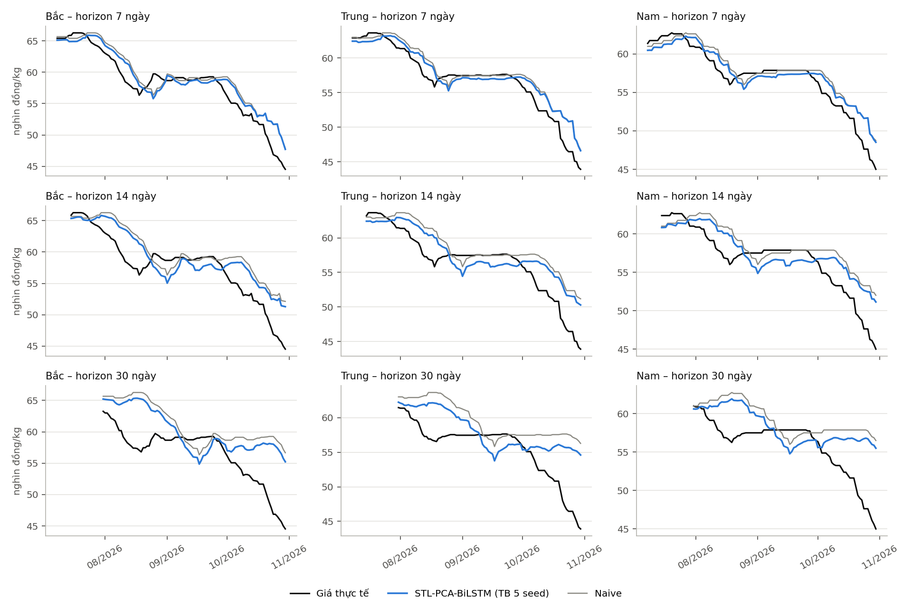
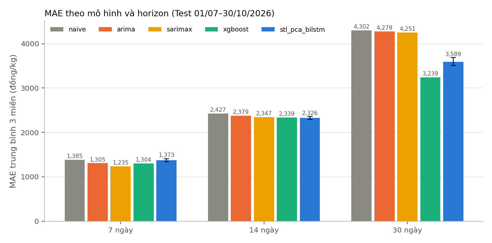

# Báo cáo P6 – STL-PCA-BiLSTM và kiểm định Diebold–Mariano

> Bản thảo các mục **2.2 (STL, PCA, mô hình lai), 3.4.3 (phần STL-PCA-BiLSTM), 3.5, 4.2 (STL-PCA-BiLSTM), 4.3 (trả lời RQ1, RQ4)**.
> Số liệu lấy từ `results/tables/` và `predictions/`; chạy lại bằng các lệnh ở `README_P6.md`.

---

## 2.2 STL, PCA và mô hình lai

### 2.2.1 Phân rã STL

STL (Seasonal–Trend decomposition using Loess) [1] tách một chuỗi thời gian thành ba thành phần cộng tính:

$$y_t = T_t + S_t + R_t,$$

trong đó $T_t$ là xu hướng (trend), $S_t$ là thành phần mùa vụ lặp lại với chu kỳ $m$ (seasonal) và $R_t$ là phần dư (residual). Thuật toán lặp hai vòng. Vòng trong lần lượt làm mịn chuỗi con theo chu kỳ (cycle-subseries) bằng hồi quy cục bộ có trọng số (loess) để ước lượng $S_t$, rồi làm mịn chuỗi đã bỏ mùa vụ để ước lượng $T_t$. Vòng ngoài tính trọng số bền vững (robust) theo độ lớn của $R_t$, nên các giá cả đột biến (ví dụ quanh Tết) ít kéo lệch xu hướng. So với phân rã cổ điển, STL cho phép mùa vụ thay đổi chậm theo thời gian và không bị mất điểm ở hai đầu chuỗi.

**Chu kỳ.** Bài gốc [5] dùng giá tuần nên đặt chu kỳ 52. Dữ liệu của nhóm là giá **ngày**, có nhịp theo tuần (cột `dow`, và 12,5% dòng là giá Chủ nhật sao chép từ ngày trước), nên chu kỳ là $m = 7$.

**Lưu ý về rò rỉ.** STL chạy trên cả chuỗi dùng quan sát ở cả hai phía của $t$ để ước lượng $T_t$ và $S_t$, nên thành phần tại ngày $t$ chứa thông tin tương lai. Nếu phân rã cả chuỗi rồi mới chia Train/Test, mô hình sẽ "nhìn trước" giá Test. Phần 3.4.3 trình bày cách nhóm thay bằng STL cuốn chiếu.

### 2.2.2 Phân tích thành phần chính (PCA)

PCA [2] tìm các hướng trực giao theo thứ tự phương sai giảm dần của dữ liệu đã chuẩn hóa. Với ma trận biến ngoại sinh $X$ (đã trừ trung bình, chia độ lệch chuẩn), phân rã trị riêng của ma trận hiệp phương sai $\Sigma = V \Lambda V^\top$ cho thành phần chính $Z = XV$. Giữ $k$ thành phần đầu sao cho tỷ lệ phương sai tích lũy

$$\frac{\sum_{i=1}^{k}\lambda_i}{\sum_{i=1}^{p}\lambda_i} \ge \tau$$

(ngưỡng $\tau$, bài gốc [5] chọn 90% và thu được 4 thành phần) thì nén được $p$ biến tương quan chặt thành $k \ll p$ biến không tương quan. Với dữ liệu của nhóm điều này đáng giá vì các biến thức ăn, nhập khẩu và thời tiết trùng thông tin nhau (cùng lag 30/60/90 ngày, cùng nhiệt độ và THI), trong khi chỉ có khoảng 270 ngày Train mỗi miền: ít đặc trưng độc lập thì BiLSTM ít bị quá khớp hơn. Có hai ràng buộc cần nhớ: (i) PCA là tuyến tính và không dùng nhãn, nên không đảm bảo giữ đúng phần thông tin hữu ích cho dự báo giá; (ii) phép chuẩn hóa và phép chiếu phải fit chỉ trên Train rồi áp nguyên cho Val và Test.

### 2.2.3 BiLSTM

LSTM [3] giữ một ô nhớ $c_t$ điều khiển bởi ba cổng (quên, vào, ra):

$$f_t=\sigma(W_f[h_{t-1},x_t]+b_f),\quad i_t=\sigma(W_i[h_{t-1},x_t]+b_i),\quad o_t=\sigma(W_o[h_{t-1},x_t]+b_o),$$
$$c_t=f_t\odot c_{t-1}+i_t\odot\tanh(W_c[h_{t-1},x_t]+b_c),\quad h_t=o_t\odot\tanh(c_t).$$

BiLSTM [4] chạy hai LSTM, một theo chiều thời gian xuôi và một theo chiều ngược trên **cùng cửa sổ đầu vào** $x_{t-L+1},\dots,x_t$, rồi nối hai trạng thái ẩn cuối: $h=[\overrightarrow{h};\overleftarrow{h}]$. Chiều ngược chỉ đọc lại cửa sổ quá khứ đã biết nên không làm rò rỉ tương lai; lợi ích là mô hình nắm được quan hệ giữa các điểm trong cửa sổ theo cả hai hướng.

### 2.2.4 Mô hình lai phân rã – giảm chiều – học sâu

Hướng "phân rã rồi dự báo" xuất phát từ ý tưởng: chuỗi giá gộp nhiều quy luật khác tốc độ (xu hướng chậm, mùa vụ đều, nhiễu), nên học từng phần dễ hơn học gộp. Với giá heo, [9] dùng mô hình lai dựa trên STL cho giá heo Trung Quốc.

Bài gốc của nhóm [5] (Liu et al., 2025, PLOS ONE) đề xuất khung *phân rã – tái cấu trúc – tối ưu*: (1) STL (chu kỳ 52 tuần) tách giá heo thành xu hướng, mùa vụ, phần dư; (2) PCA nén các yếu tố ảnh hưởng đã lọc bằng tương quan Spearman (4 thành phần đạt 90% phương sai); (3) BiLSTM nhận cả thành phần STL và điểm PCA; (4) siêu tham số BiLSTM (số nơ-ron ẩn, số epoch, tốc độ học, hệ số L1) được tìm bằng thuật toán tối ưu cá voi trắng (BWO). Bài so sánh với ARIMA, Prophet, LSTM, GRU, N-BEATS và nhiều biến thể BiLSTM tối ưu bằng GA, PSO, DBO, WOA, trên chuỗi giá tuần Trung Quốc 2016–2024 (418 tuần).

Có một số điểm mà đề tài của nhóm làm khác bài gốc (khớp với khoảng trống nêu ở 2.4.3); các điểm này được đọc từ bản đăng của bài gốc và cần kiểm tra lại khi viết 2.4.3:

| Nội dung | Bài gốc [5] | Đề tài nhóm |
|---|---|---|
| Dữ liệu | Giá tuần, Trung Quốc | Giá ngày, 3 miền Việt Nam |
| Độ trễ giá thức ăn | Chưa xét (theo mô tả) | Có biến lag 30/60/90 ngày (E2) |
| Dự báo nhiều bước | Không trình bày rõ chiến lược | Trực tiếp (direct) cho từng horizon 7, 14, 30 ngày |
| Chọn siêu tham số | Hàm mục tiêu nêu là MSE trên tập kiểm tra (mục 4.2.4) | Chỉ trên Val; Test không tham gia |
| Tối ưu siêu tham số | BWO | Lưới nhỏ trên Val (BWO để hướng tiếp theo) |

Hệ quả cho việc đối chiếu số liệu: sai số của nhóm không so trực tiếp được với con số của bài gốc vì khác thị trường, tần suất và đơn vị.

---

## 3.4.3 Cài đặt mô hình – STL-PCA-BiLSTM

### 3.4.3.1 Quy trình

Mô hình STL-PCA-BiLSTM của nhóm gồm bốn bước, chạy riêng cho từng horizon $h \in \{7, 14, 30\}$ ngày (chiến lược trực tiếp, mỗi horizon một mô hình) và gộp ba miền vào một mạng có thêm biến định danh miền:

1. **STL cuốn chiếu** trên `price_ffill` của từng miền, chu kỳ 7. Tại ngày $t$, STL chỉ nhận tối đa 84 ngày gần nhất kết thúc ở $t$ (cần ít nhất 28 ngày) và lấy giá trị cuối của trend, seasonal, residual. Ba ngày không có giá (20–22/02/2026, giữa Tết) được điền bằng giá ngày trước đó, chỉ dùng quá khứ. Tổng ba thành phần luôn bằng giá (đã có test).
2. **PCA** trên 37 biến ngoại sinh: các nhóm E1 (lịch và Tết), E2 (thức ăn), E3 (cung–cầu), E4 (dịch bệnh), E5 (thời tiết và vĩ mô) của cấu hình c6. Nhóm E0 (giá và lag giá) không đưa vào PCA vì STL đã thay vai trò đó. Bốn cột `*_lag90` bị bỏ vì thiếu 12% ngày đầu Train (README mục 7, quy tắc 5: thống nhất một cách xử lý); đây là lựa chọn của P6, cần nhóm xác nhận. Các biến được chuẩn hóa, cắt ở ±5 độ lệch chuẩn để giá trị ngoài miền Train không làm nổ đầu vào, rồi chiếu PCA có whiten. Scaler và PCA chỉ fit trên Train.
3. **Chuỗi đầu vào** cho điểm gốc $t$ là cửa sổ $L$ ngày gần nhất, mỗi ngày gồm 3 + $k$ kênh: $T_s - T_t$ (xu hướng so với ngày $t$, để không phụ thuộc mức giá tuyệt đối), $S_s$, $R_s$ và $k$ thành phần chính. Ba kênh đầu chuẩn hóa theo độ lệch chuẩn trên Train.
4. **BiLSTM**: một lớp hai chiều với $H$ nơ-ron ẩn mỗi chiều; nối trạng thái cuối của hai chiều với one-hot miền, qua Dropout, Linear($2H+3 \to H$), ReLU, Dropout, Linear($H \to 1$). Mục tiêu là $\Delta = y_{t+h} - \text{price}_t$ (như P4), chuẩn hóa theo trung bình và độ lệch chuẩn của các dòng huấn luyện; giá dự báo là $\text{price}_t + \hat\Delta$. Hàm mất mát SmoothL1, tối ưu Adam (weight decay $10^{-4}$), batch 64, cắt gradient ở 1.

So với bài gốc [5], nhóm không dự báo riêng từng thành phần STL rồi cộng lại mà đưa các thành phần cùng điểm PCA vào một mạng học $\Delta$. Cách này gọn hơn và khớp với XGBoost của P4, nhưng không phải bản sao thuật toán của bài; cần nêu rõ khi so sánh.

### 3.4.3.2 Chọn siêu tham số trên Val

Lưới 48 tổ hợp: cửa sổ $L \in \{14, 28\}$, $H \in \{16, 32, 64\}$, dropout $\in \{0{,}1;\, 0{,}3\}$, tốc độ học $\in \{10^{-3}, 3\cdot10^{-3}\}$, ngưỡng phương sai PCA $\in \{90\%, 95\%\}$, tối đa 60 epoch. Với mỗi tổ hợp, huấn luyện **chỉ trên Train** (các điểm gốc có $t+h \le$ 31/03/2026) bằng hai seed (42, 43), tính MAE trên Val (01/04–30/06/2026) sau mỗi epoch, lấy trung bình hai seed và chọn epoch có MAE thấp nhất. Tổ hợp có MAE Val thấp nhất được giữ, riêng từng horizon. Test không tham gia ở bước nào. Khác bài gốc [5]: mục 4.2.4 của bài nêu hàm mục tiêu của thuật toán tối ưu là MSE trên tập kiểm tra (mục 3.7 của bài mô tả khác, nên cần đối chiếu lại bản gốc trước khi in).

| Horizon (ngày) | Cửa sổ L | Hidden H | Dropout | Tốc độ học | Ngưỡng PCA | Epoch | MAE Val (đồng/kg) | % tổ hợp có epoch tốt nhất ≤ 3 |
|---|---|---|---|---|---|---|---|---|
| 7 | 14 | 64 | 0,1 | 1e-3 | 90% (12 PC) | 1 | 741 | 81% |
| 14 | 14 | 64 | 0,3 | 1e-3 | 95% (15 PC) | 1 | 1394 | 75% |
| 30 | 28 | 64 | 0,3 | 1e-3 | 95% (15 PC) | 1 | 2509 | 65% |

*Bảng 3.x. Siêu tham số chọn trên Val (nguồn: `results/tables/3_4_3_stl_pca_bilstm_params.json`, `3_4_3_stl_pca_bilstm_val_grid.csv`).*

**Điểm cần lưu ý:** Val chọn **epoch = 1** cho cả ba horizon, và phần lớn tổ hợp đạt MAE Val thấp nhất ngay ở 1–3 epoch. Nghĩa là càng huấn luyện lâu mạng càng tệ trên Val. MAE Val tốt nhất (741, 1394, 2509 đồng/kg) gần bằng hoặc kém Naive trên cùng điểm gốc (752, 1324, 2513). Nguyên nhân phù hợp với số liệu: trung bình $\Delta$ ở Train dương (+31, +204, +404 đồng/kg cho h = 7, 14, 30; giá đang tăng) nhưng âm ở Val (−77, −158, −294), tức quy luật học từ Train không giữ sang Val. Vì vậy mô hình cuối cùng được huấn luyện rất ít (một epoch chỉ khoảng 11–20 bước tối ưu); mục 4.2 trình bày hệ quả và một phân tích độ nhạy với 30 epoch cố định.

### 3.4.3.3 Huấn luyện lại theo walk-forward và chạy nhiều seed

Tại mỗi mốc 01/07, 01/08, 01/09, 01/10/2026, mạng được huấn luyện lại từ đầu trên mọi điểm gốc đã lộ nhãn ($t + h <$ ngày huấn luyện lại), cửa sổ mở rộng dần, với số epoch cố định bằng giá trị đã chọn trên Val. Scaler và PCA giữ nguyên bản fit trên Train. Dự báo của tháng đó chỉ dùng mạng của mốc tương ứng. Tháng 10 với $h=30$ không còn điểm gốc nào có $t+h \le$ 30/10 nên bị bỏ (khớp với Naive: 237 điểm gốc, 79 mỗi miền). Mỗi cấu hình chạy 5 seed (42–46); file dự báo chính là trung bình dự báo của 5 seed, file từng seed nằm trong `predictions/seeds/`.

### 3.4.3.4 Biện pháp chống rò rỉ

- STL cuốn chiếu thay cho STL cả chuỗi (mục 2.2.1). Hàm `assert_no_leak` tính lại thành phần STL tại các ngày ngẫu nhiên chỉ từ dữ liệu đến ngày đó và yêu cầu khớp; test `test_future_values_do_not_change_past_components` phá hỏng giá tương lai và yêu cầu thành phần quá khứ không đổi.
- Scaler và PCA chỉ fit trên Train: test thay mọi biến ngoại sinh của Val/Test bằng giá trị khác và yêu cầu ma trận thành phần không đổi.
- Cửa sổ đầu vào chỉ dùng ngày $\le t$ (test phá hỏng thành phần sau ngày cắt, cửa sổ tại ngày cắt không đổi).
- Dòng huấn luyện luôn có $t + h <$ ngày huấn luyện lại; điểm gốc đánh giá trùng chính xác tập của P3/P4.
- Tất cả 12 test của `tests/test_p6_stl_pca.py` đạt; bộ test chung 48/48 đạt.

Môi trường: Python 3.13, PyTorch 2.11 (CPU), statsmodels 0.15 (STL), scikit-learn 1.8, pandas 3.0; seed cố định 42–46.

---

## 3.5 Đánh giá

### 3.5.1 Chỉ số sai số

Với $n$ cặp (giá thực $y_i$, giá dự báo $\hat y_i$), mỗi nhóm (mô hình, miền, horizon) được chấm bằng:

$$\mathrm{MAE}=\frac1n\sum_i|y_i-\hat y_i|,\quad \mathrm{RMSE}=\sqrt{\frac1n\sum_i(y_i-\hat y_i)^2},\quad \mathrm{MAPE}=\frac{100}{n}\sum_i\left|\frac{y_i-\hat y_i}{y_i}\right|.$$

MAE (đồng/kg) là chỉ số chính vì dễ diễn giải với người nuôi; RMSE phạt nặng sai số lớn; MAPE (%) để so giữa các miền và horizon. Các quy tắc chấm chung cho mọi mô hình (hàm `evaluate_predictions` của P3):

- Chỉ chấm điểm gốc $t$ trong Test sao cho $t+h \le$ 30/10/2026; bỏ dòng có nhãn thiếu và dòng gốc là giá Chủ nhật sao chép. Kết quả: $n$ = 99, 93, 79 mỗi miền cho horizon 7, 14, 30 (tổng 297, 279, 237), **giống hệt** tập của Naive, ARIMA/SARIMAX và XGBoost nên các bảng so sánh được trên cùng điểm gốc.
- Báo cáo từng miền và **trung bình ba miền** (TB: trung bình số học của chỉ số ba miền).
- Mô hình học sâu chạy 5 seed (42–46): bảng chính ghi trung bình ± độ lệch chuẩn của chỉ số từng seed; file dự báo chính là trung bình dự báo của 5 seed (mô hình tập hợp), chấm riêng.
- Naive (giá hôm nay làm dự báo) có trong mọi bảng làm mốc.

### 3.5.2 Kiểm định Diebold–Mariano

Bảng MAE cho biết mô hình nào thấp hơn trên mẫu, nhưng với $n$ chỉ khoảng 80–100 điểm gốc một miền thì chênh lệch nhỏ có thể do ngẫu nhiên. Kiểm định Diebold–Mariano (DM) [6] kiểm định giả thuyết $H_0$: hai mô hình có độ chính xác dự báo bằng nhau. Với hai chuỗi sai số $e^A_t, e^B_t$ và hàm tổn thất $L$ ($L=|e|$ hoặc $e^2$), đặt $d_t=L(e^A_t)-L(e^B_t)$. Thống kê là

$$\mathrm{DM}=\frac{\bar d}{\sqrt{\widehat{\mathrm{LRV}}/n}},\qquad \widehat{\mathrm{LRV}}=\gamma_0+2\sum_{k=1}^{h-1}w_k\gamma_k,$$

với $\gamma_k$ là hiệp phương sai bậc $k$ của $d_t$. Dự báo $h$ ngày tại hai ngày gốc liền kề chồng lấn nhau nên $d_t$ tự tương quan đến bậc $h-1$; đó là lý do tổng chạy đến $h-1$. Nhóm áp dụng ba điều chỉnh:

1. **Hiệu chỉnh Harvey–Leybourne–Newbold** [7]: nhân DM với $\sqrt{\frac{n+1-2h+h(h-1)/n}{n}}$ và so với phân phối $t_{n-1}$ thay cho chuẩn, vì mẫu nhỏ làm DM gốc nghiêng về bác bỏ $H_0$. Đây là hiệu chỉnh cho sai số chồng lấn mà sườn báo cáo nêu.
2. **Lập chuỗi theo lịch ngày.** $\gamma_k$ tính trên lưới ngày liên tục, chỉ lấy các cặp $(t,t+k)$ mà cả hai ngày đều có dự báo, vì Chủ nhật sao chép và nhãn thiếu tạo khoảng trống. Nếu đánh số lại theo thứ tự quan sát thì bậc tự tương quan bị lệch.
3. **Kiểm tra độ bền bằng kernel Bartlett** [8] ($w_k=1-k/h$). Với trọng số bằng 1 (DM gốc, $w_k=1$), ước lượng phương sai có thể $\le 0$ hoặc rất nhỏ khi $h$ lớn so với $n$ (ví dụ $h=30$, $n=79$), cho NaN hoặc thống kê phồng. Bartlett luôn không âm. Khi hai kết quả khác nhau rõ rệt, báo cáo dùng kết quả Bartlett và ghi chú.

Quy ước dấu: $\mathrm{DM}<0$ nghĩa là mô hình A có tổn thất nhỏ hơn B. p-value hai phía. Tổn thất chính là $|e|$ (cùng thước đo với MAE); $e^2$ được tính kèm trong `results/tables/4_3_dm_pvalues.csv`. Ba miền chịu chung cú sốc giá (dịch bệnh, Tết), nên không gộp chúng thành 3 mẫu độc lập: mức "tất cả" (`all`) là trung bình hiệu tổn thất của ba miền tại từng ngày gốc rồi chạy DM trên chuỗi trung bình đó. Cần lưu ý ba hạn chế: (i) so sánh nhiều cặp và nhiều horizon mà không hiệu chỉnh đa so sánh, nên p-value cận 0,05 chỉ là gợi ý; (ii) kiểm định DM không xét việc mô hình đã được huấn luyện lại hằng tháng; (iii) Test chỉ có 122 ngày nên công suất kiểm định thấp, "không khác biệt có ý nghĩa" không có nghĩa là hai mô hình bằng nhau.

### 3.5.3 Ablation và SHAP (mô tả phương pháp)

Ablation cộng dồn theo sáu cấu hình $c_1$ đến $c_6$ với thứ tự nhóm biến E0 → E2 → E1 → E3 → E4 → E5 (E0 giá lịch sử; E2 thức ăn; E1 lịch và Tết; E3 cung–cầu; E4 dịch bệnh; E5 thời tiết và vĩ mô). Mức giảm sai số khi thêm một nhóm cho thấy đóng góp của nhóm đó; so $c_1$ với $c_2$ trả lời RQ2, so các bước còn lại trả lời RQ3. SHAP (TreeExplainer trên XGBoost) xếp hạng từng biến, kiểm tra chéo kết quả ablation. Kết quả ablation và SHAP trình bày ở mục 4.4, không thuộc phạm vi mục này; riêng STL-PCA-BiLSTM chỉ chạy cấu hình $c_6$ vì đầu vào đã qua PCA nên không tách được từng nhóm biến.

---

## 4.2 Kết quả STL-PCA-BiLSTM theo horizon

Kết quả trên Test (01/07–30/10/2026) của mô hình đã chọn theo quy trình ở 3.4.3: siêu tham số và số epoch chọn trên Val, huấn luyện lại 4 lần theo tháng, 5 seed. Mỗi ô là trung bình ± độ lệch chuẩn của chỉ số tính riêng cho từng seed; "Trung bình 3 miền" là trung bình số học của ba miền.

| Horizon (ngày) | Miền | n | MAE (đồng/kg) | RMSE (đồng/kg) | MAPE (%) |
|---|---|---|---|---|---|
| 7 | Bắc | 99 | 1556 ± 37 | 1949 ± 44 | 2,82 ± 0,07 |
|  | Trung | 99 | 1299 ± 34 | 1663 ± 66 | 2,43 ± 0,07 |
|  | Nam | 99 | 1267 ± 38 | 1546 ± 46 | 2,33 ± 0,07 |
|  | Trung bình 3 miền | 297 | 1374 ± 36 | 1719 ± 51 | 2,53 ± 0,07 |
| 14 | Bắc | 93 | 2636 ± 50 | 3141 ± 79 | 4,80 ± 0,10 |
|  | Trung | 93 | 2247 ± 42 | 2731 ± 62 | 4,22 ± 0,08 |
|  | Nam | 93 | 2099 ± 37 | 2498 ± 60 | 3,88 ± 0,07 |
|  | Trung bình 3 miền | 279 | 2327 ± 30 | 2790 ± 59 | 4,30 ± 0,06 |
| 30 | Bắc | 79 | 4367 ± 103 | 5312 ± 140 | 8,11 ± 0,20 |
|  | Trung | 79 | 3280 ± 174 | 4233 ± 232 | 6,28 ± 0,33 |
|  | Nam | 79 | 3157 ± 110 | 4088 ± 162 | 5,98 ± 0,21 |
|  | Trung bình 3 miền | 237 | 3602 ± 89 | 4545 ± 141 | 6,79 ± 0,17 |

*Bảng 4.x. STL-PCA-BiLSTM theo horizon và miền (nguồn: `results/tables/4_2_stl_pca_bilstm_mae_horizon.csv`). Dự báo trung bình 5 seed nằm ở `predictions/stl_pca_bilstm_c6.csv`.*

*Hình 4.x. Giá thực tế, Naive và dự báo trung bình 5 seed theo ngày đích, ba miền × ba horizon.*

**Nhận xét.**

- **Độ ổn định theo seed khá tốt.** Độ lệch chuẩn của MAE trung bình ba miền là 36, 30 và 89 đồng/kg cho h = 7, 14, 30, nhỏ hơn nhiều so với chênh lệch giữa các mô hình ở h = 30 nhưng cùng cỡ chênh lệch với Naive ở h = 7.
- **So với Naive (MAE trung bình ba miền):** -0,8% ở h = 7, -4,1% ở h = 14, -16,3% ở h = 30. Ở h = 7, mức chênh (11 đồng/kg) nhỏ hơn độ lệch chuẩn giữa các seed (36) nên coi là ngang Naive. Cải thiện rõ nhất ở h = 30, nơi Naive kém nhất vì giá giảm mạnh cuối kỳ; hình 4.x cho thấy mọi mô hình đều chậm hơn đợt giảm sâu tháng 10 và dự báo 30 ngày của mô hình chỉ lệch bớt theo hướng đi xuống chứ không bắt kịp.
- **Theo miền:** miền Bắc có sai số cao nhất ở mọi horizon (ví dụ h = 30: 4367 đồng/kg so với 3157 ở miền Nam); đồng thời biến động giữa các seed lớn hơn ở h = 30 (174 đồng/kg ở miền Trung).

**Vì sao cần đọc kết quả này thận trọng.** Epoch chọn trên Val bằng 1, nên mạng cuối cùng gần như chưa được huấn luyện. Hai kiểm tra bổ sung (bảng dưới) cho thấy:

| Horizon (ngày) | Naive | Naive + trôi trung bình | STL-PCA-BiLSTM (epoch chọn trên Val = 1) | STL-PCA-BiLSTM (epoch cố định 30) |
|---|---|---|---|---|
| 7 | 1385 | 1362 | 1374 ± 36 | 1717 ± 87 |
| 14 | 2427 | 2403 | 2327 ± 30 | 2486 ± 46 |
| 30 | 4302 | 4288 | 3602 ± 89 | 3283 ± 232 |

*Bảng 4.x. MAE trung bình ba miền (đồng/kg) của các biến thể. "Naive + trôi trung bình" là giá hiện tại cộng trung bình $\Delta$ của các dòng đã lộ nhãn, tính cùng lịch walk-forward (`results/tables/4_2_diagnostic_naive_drift.csv`). Cột cuối là phân tích độ nhạy, không phải mô hình chính (`results/tables/4_2_stl_pca_bilstm_epochs30_sensitivity.csv`).*

1. **Phần cải thiện ở h = 30 không đến từ số hạng trôi trung bình.** "Naive + trôi" gần như bằng Naive ở mọi horizon, trong khi mạng đạt thấp hơn Naive 700 đồng/kg ở h = 30. Mạng chỉ sau vài chục bước tối ưu (một epoch khoảng 11–20 batch) đã học được một phần quan hệ giữa chuỗi đầu vào và $\Delta$; cơ chế cụ thể (ví dụ ngoại suy độ dốc kênh xu hướng) **chưa được kiểm chứng**, nên báo cáo không khẳng định.
2. **Chọn epoch trên Val không phải lựa chọn tối ưu cho Test ở mọi horizon.** Với 30 epoch cố định (giá trị mặc định đặt trước khi chạy Test), sai số **tệ hơn** ở h = 7 (1717, kém Naive) và h = 14 nhưng **tốt hơn** ở h = 30 (3283). Nhóm không đổi mô hình chính theo kết quả này vì đó là chọn theo Test; chỉ ghi lại như phân tích độ nhạy: kết luận về STL-PCA-BiLSTM phụ thuộc mạnh vào mức huấn luyện, và với chỉ 273 ngày Train, Val chưa đủ để chọn số epoch ổn định.

**Hạn chế riêng của mục này:** (i) chỉ cấu hình c6, nên không tách được đóng góp từng nhóm biến (PCA trộn các nhóm); (ii) Val (91 ngày, giá đi ngang đến đi xuống nhẹ) khác Train (giá tăng mạnh) và khác Test (giá giảm sâu) nên việc chọn tham số trên Val có thể không chuyển sang Test; (iii) chưa chạy đánh giá riêng thành phần PCA (tải trọng, ý nghĩa từng PC), nên chưa diễn giải được nhóm biến nào hữu ích.

---

## 4.3 So sánh mô hình và kiểm định Diebold–Mariano

Bảng so sánh gồm năm mô hình có dự báo trong repo tại thời điểm viết: Naive, ARIMA, SARIMAX (P3), XGBoost (P4) và STL-PCA-BiLSTM (P6), đều chạy cấu hình c6 trên cùng tập điểm gốc Test. **LSTM và BiLSTM (P5) chưa có dự báo**, và file XGBoost lấy từ nhánh `feature/p4-khanhngoc` (chưa merge vào `main`; cách tái lập ở `README_P6.md`). Vì vậy câu trả lời RQ1 và RQ4 dưới đây là **bản nháp, chưa đủ sáu mô hình**; khi P5 và P4 merge, chạy lại `python src/p6_report_assets.py` sẽ cập nhật mọi bảng.

### 4.3.1 Bảng MAE, RMSE, MAPE theo horizon

| Horizon (ngày) | Mô hình | n | MAE | RMSE | MAPE (%) |
|---|---|---|---|---|---|
| 7 | Naive | 297 | 1385 | 1835 | 2,56 |
|  | ARIMA | 297 | 1305 | 1738 | 2,41 |
|  | SARIMAX | 297 | **1235** | **1652** | **2,27** |
|  | XGBoost | 297 | 1304 | 1729 | 2,41 |
|  | STL-PCA-BiLSTM | 297 | 1373 | 1717 | 2,53 |
| 14 | Naive | 279 | 2427 | 3192 | 4,53 |
|  | ARIMA | 279 | 2379 | 3119 | 4,44 |
|  | SARIMAX | 279 | 2347 | 3058 | 4,37 |
|  | XGBoost | 279 | 2339 | 2846 | **4,29** |
|  | STL-PCA-BiLSTM | 279 | **2326** | **2784** | 4,30 |
| 30 | Naive | 237 | 4302 | 5399 | 8,11 |
|  | ARIMA | 237 | 4279 | 5372 | 8,07 |
|  | SARIMAX | 237 | 4251 | 5335 | 8,02 |
|  | XGBoost | 237 | **3239** | 4584 | **6,25** |
|  | STL-PCA-BiLSTM | 237 | 3589 | **4535** | 6,77 |

*Bảng 4.x. Sai số trung bình ba miền trên Test (đồng/kg; in đậm là thấp nhất mỗi cột và horizon). STL-PCA-BiLSTM là mô hình chính (epoch chọn trên Val) ở dạng tập hợp: dự báo là trung bình của 5 seed rồi mới chấm, nên MAE hơi thấp hơn trung bình MAE từng seed ở bảng 4.2 (h = 30: 3589 so với 3602). Nguồn: `results/tables/4_3_model_comparison.csv`.*

*Hình 4.x. MAE trung bình ba miền; thanh sai số của STL-PCA-BiLSTM là độ lệch chuẩn qua 5 seed.*

| Horizon (ngày) | Miền | Naive | ARIMA | SARIMAX | XGBoost | STL-PCA-BiLSTM |
|---|---|---|---|---|---|---|
| 7 | Bắc | 1638 | 1638 | **1424** | 1542 | 1556 |
|  | Trung | 1282 | **1137** | 1139 | 1266 | 1298 |
|  | Nam | 1235 | 1140 | 1142 | **1103** | 1266 |
| 14 | Bắc | 2783 | 2783 | 2682 | **2521** | 2635 |
|  | Trung | 2307 | **2232** | 2233 | 2296 | 2245 |
|  | Nam | 2192 | 2124 | 2126 | 2198 | **2098** |
| 30 | Bắc | 5056 | 5056 | 4971 | **3572** | 4360 |
|  | Trung | 4194 | 4137 | 4137 | **3149** | 3273 |
|  | Nam | 3655 | 3644 | 3645 | **2994** | 3134 |

*Bảng 4.x. MAE theo từng miền (đồng/kg).*

### 4.3.2 Kiểm định Diebold–Mariano

| Cặp (A vs B) | Δ̄ h7 | p HLN h7 | p Bartlett h7 | Δ̄ h14 | p HLN h14 | p Bartlett h14 | Δ̄ h30 | p HLN h30 | p Bartlett h30 |
|---|---|---|---|---|---|---|---|---|---|
| Naive vs ARIMA | +80 | 0,012 | 0,003 | +48 | 0,172 | 0,114 | +23 | n/a | 0,369 |
| Naive vs SARIMAX | +150 | 0,024 | 0,006 | +80 | 0,293 | 0,216 | +51 | n/a | 0,316 |
| Naive vs XGBoost | +81 | 0,738 | 0,667 | +89 | 0,890 | 0,872 | +1063 | 0,249 | 0,268 |
| Naive vs STL-PCA-BiLSTM | +12 | 0,930 | 0,909 | +101 | 0,790 | 0,742 | +713 | 0,029 | 0,169 |
| ARIMA vs STL-PCA-BiLSTM | -68 | 0,562 | 0,458 | +53 | 0,880 | 0,853 | +690 | 0,043 | 0,183 |
| SARIMAX vs STL-PCA-BiLSTM | -138 | 0,157 | 0,082 | +21 | 0,948 | 0,937 | +662 | 0,047 | 0,188 |
| XGBoost vs STL-PCA-BiLSTM | -69 | 0,655 | 0,578 | +12 | 0,973 | 0,971 | -351 | 0,734 | 0,716 |

*Bảng 4.x. Kiểm định DM–HLN, tổn thất |e|, mức "tất cả" (trung bình hiệu tổn thất của ba miền tại từng ngày gốc). Δ̄ = (MAE của A) − (MAE của B) tính trên điểm gốc chung (đồng/kg): dương nghĩa là B tốt hơn A. p hai phía; cột "HLN" là DM gốc có hiệu chỉnh Harvey, cột "Bartlett" là kiểm tra độ bền (mục 3.5.2). Đầy đủ theo từng miền và tổn thất e² ở `results/tables/4_3_dm_pvalues.csv`.*

Quy ước đọc: chỉ coi là khác biệt đáng tin khi **cả hai** cột p cùng nhỏ hơn 0,05. Ở h = 30, DM gốc ($n = 79$, nhiều lag) không ổn định: có cặp không tính được (n/a) hoặc cho p rất nhỏ giả tạo (ví dụ ARIMA vs SARIMAX p = 0,0001 trong khi Bartlett cho 0,340), nên với h = 30 ưu tiên cột Bartlett.

### 4.3.3 Trả lời RQ1 – mô hình nào dự báo tốt nhất ở horizon 7, 14 và 30 ngày?

*(Tạm thời, trong số năm mô hình hiện có.)*

- **h = 7: SARIMAX thấp nhất** (MAE 1235, RMSE 1652, MAPE 2,27%). Chênh với Naive có ý nghĩa ở cả hai cột (SARIMAX vs Naive p = 0,024 / 0,006; ARIMA vs Naive p = 0,012 / 0,003), nhưng khác biệt giữa SARIMAX và XGBoost hay STL-PCA-BiLSTM không có ý nghĩa (p ≥ 0,08). Theo miền: ở miền Bắc ARIMA(0,1,0) trùng Naive và chỉ SARIMAX (thêm biến lịch tuần) cải thiện (1424 so với 1638); ở Nam và Trung ARIMA và SARIMAX gần như bằng nhau và cùng tốt hơn Naive.
- **h = 14: không có mô hình thắng rõ.** STL-PCA-BiLSTM thấp nhất về MAE (2326) và RMSE (2784), XGBoost thấp nhất về MAPE (4,29%), nhưng chênh lệch giữa chúng và SARIMAX không đến 1% và mọi p-value đều lớn hơn 0,1 (kể cả so với Naive: p ≥ 0,11).
- **h = 30: XGBoost thấp nhất về MAE** (3239) và MAPE (6,25%); STL-PCA-BiLSTM thấp nhất về RMSE (4535 so với 4584). STL-PCA-BiLSTM và XGBoost giảm MAE lần lượt khoảng 17% và 25% so với Naive (4302), nhưng **DM không xác nhận**: STL-PCA-BiLSTM vs Naive p = 0,029 (HLN) nhưng 0,169 (Bartlett); XGBoost vs Naive p = 0,249 / 0,268; giữa STL-PCA-BiLSTM và XGBoost p ≈ 0,72–0,73. Với 79 điểm gốc mỗi miền tập trung vào một đợt giá giảm, chênh lệch hàng nghìn đồng/kg vẫn chưa đủ chắc.

Kết luận tạm cho RQ1: nhóm mô hình thống kê (SARIMAX) tốt nhất ở horizon ngắn (7 ngày), nhóm có biến ngoại sinh và học máy (XGBoost, STL-PCA-BiLSTM) có sai số thấp nhất ở horizon dài (14 và 30 ngày); sai số của mọi mô hình tăng nhanh theo horizon (MAE Naive tăng từ 1385 lên 4302). Nhưng chỉ có một so sánh (SARIMAX/ARIMA so với Naive ở h = 7) đạt ý nghĩa thống kê ở cả hai kiểm định.

### 4.3.4 Trả lời RQ4 – deep learning có thắng ML và Naive không?

*(Tạm thời: mới có một mô hình deep learning là STL-PCA-BiLSTM; LSTM và BiLSTM của P5 chưa có.)*

- **So với Naive:** MAE thấp hơn 4,2% ở h = 14 và 16,6% ở h = 30, ngang ở h = 7 (-0,8%). Chỉ riêng h = 30 có p-value HLN nhỏ (0,029), nhưng Bartlett cho 0,169, nên **không đủ để kết luận mô hình thắng Naive**.
- **So với ML (XGBoost):** STL-PCA-BiLSTM kém hơn ở h = 7 (+5,3% MAE) và h = 30 (+10,8%), hơn không đáng kể ở h = 14 (-0,5%, p = 0,97). Không có horizon nào mô hình học sâu thắng XGBoost có ý nghĩa; RMSE ở h = 14 và 30 thấp hơn XGBoost một chút nhưng cũng không có ý nghĩa thống kê.
- **Độ nhạy:** kết quả của mô hình học sâu thay đổi nhiều theo số epoch (mục 4.2); với 30 epoch cố định mô hình tệ hơn Naive ở h = 7 và 14. Do đó không có cơ sở để nói học sâu ổn định hơn học máy trong bộ dữ liệu này.

Kết luận tạm cho RQ4: **chưa có bằng chứng rằng deep learning thắng ML hay Naive**. Mô hình học sâu duy nhất đã chạy ngang hoặc kém XGBoost và chỉ có MAE thấp hơn Naive ở h = 14 và 30 và mức hơn đó chưa vững về mặt thống kê. Cần nói rõ hai điều về cách đặt câu hỏi: (1) RQ4 ghi "khoảng 400 ngày quan sát độc lập", nhưng tập Test chỉ có 122 ngày (79–99 điểm gốc mỗi miền sau khi lọc), và các điểm gốc liền kề chồng lấn nhau nên không độc lập; 486 ngày là toàn bộ dữ liệu gồm cả Train và Val. Đề nghị sửa câu hỏi thành "trên 122 ngày Test". (2) Giai đoạn Test có giá giảm sâu cuối kỳ nên thứ hạng giữa các mô hình có thể khác ở giai đoạn khác; với chuỗi 486 ngày, kết luận chỉ áp dụng cho giai đoạn này.

### 4.3.5 Hạn chế của phần so sánh

- Chưa đủ sáu mô hình của RQ1 (thiếu LSTM, BiLSTM); các cặp DM với hai mô hình này sẽ được thêm khi có file dự báo.
- Test ngắn, giá giảm sâu ở tháng 10 làm mọi mô hình chậm nhịp; không hiệu chỉnh đa so sánh cho 42 p-value trong bảng 4.x.
- Theo mã `xgb_model.py` trên nhánh P4 hiện tại, XGBoost không có bước chọn tham số trên Val (dùng tham số mặc định), STL-PCA-BiLSTM có chọn trên Val; hai mô hình không được chọn tham số công bằng như nhau.
- Hai cách tính DM (HLN và Bartlett) có thể cho kết luận khác nhau; báo cáo nêu cả hai và chỉ coi khác biệt là đáng tin khi cả hai đồng thuận.

---

## Tài liệu tham khảo (phần của P6, IEEE)

**Tiếng Anh**

[1] R. B. Cleveland, W. S. Cleveland, J. E. McRae, and I. Terpenning, "STL: A seasonal-trend decomposition procedure based on loess," *Journal of Official Statistics*, vol. 6, no. 1, pp. 3–73, 1990.

[2] I. T. Jolliffe, *Principal Component Analysis*, 2nd ed. New York, NY, USA: Springer, 2002.

[3] S. Hochreiter and J. Schmidhuber, "Long short-term memory," *Neural Computation*, vol. 9, no. 8, pp. 1735–1780, 1997.

[4] M. Schuster and K. K. Paliwal, "Bidirectional recurrent neural networks," *IEEE Transactions on Signal Processing*, vol. 45, no. 11, pp. 2673–2681, 1997.

[5] X. Liu, Y. Li, F. Wang, Y. Qin, and Z. Lyu, "Decomposition-reconstruction-optimization framework for hog price forecasting: Integrating STL, PCA, and BWO-optimized BiLSTM," *PLOS ONE*, vol. 20, no. 6, e0324646, 2025, doi: 10.1371/journal.pone.0324646.

[6] F. X. Diebold and R. S. Mariano, "Comparing predictive accuracy," *Journal of Business & Economic Statistics*, vol. 13, no. 3, pp. 253–263, 1995.

[7] D. Harvey, S. Leybourne, and P. Newbold, "Testing the equality of prediction mean squared errors," *International Journal of Forecasting*, vol. 13, no. 2, pp. 281–291, 1997.

[8] W. K. Newey and K. D. West, "A simple, positive semi-definite, heteroskedasticity and autocorrelation consistent covariance matrix," *Econometrica*, vol. 55, no. 3, pp. 703–708, 1987.

[9] Deng, Zhu, and Xu, 2022, *Computers and Electronics in Agriculture*, vol. 198, 107068. *(Tên bài lấy từ gợi ý của sườn; người phụ trách mục 2.4.1 bổ sung tên đầy đủ khi chuẩn hóa tài liệu tham khảo.)*
